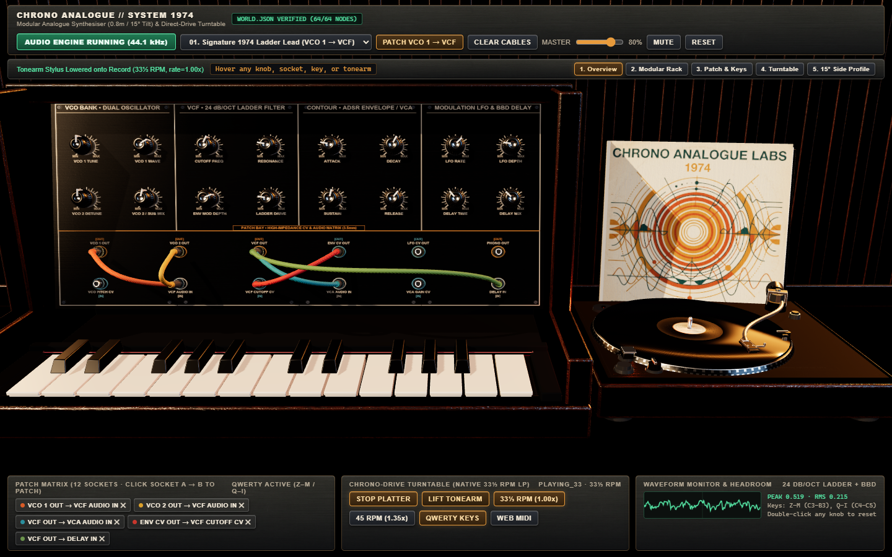
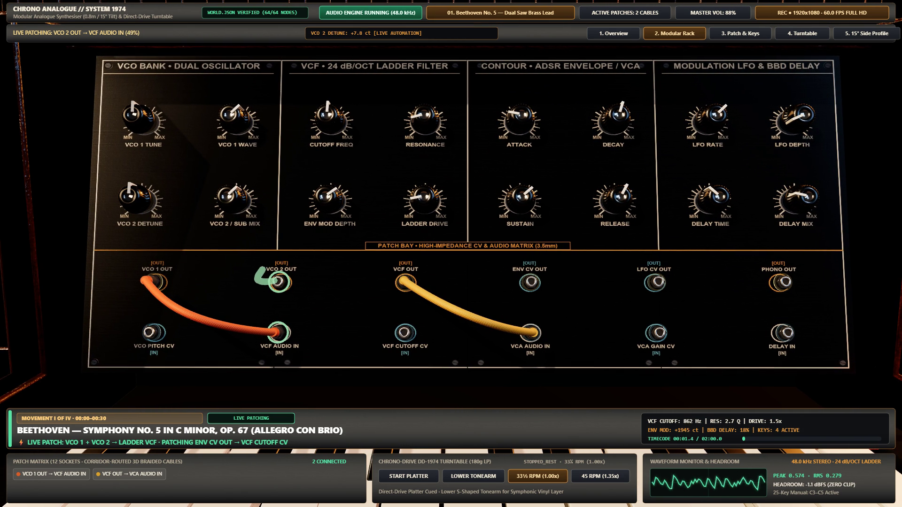
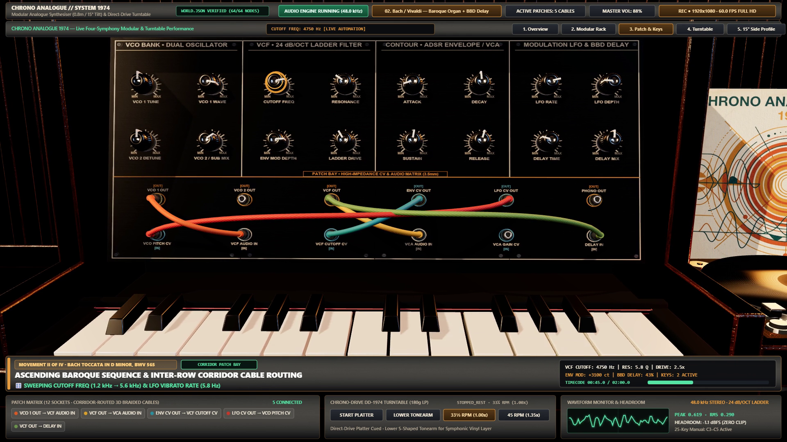
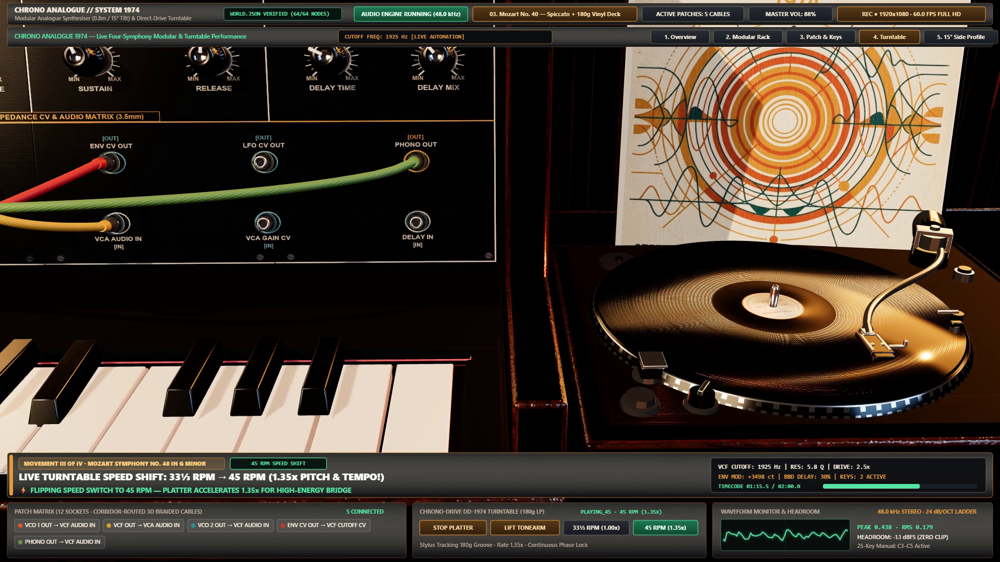
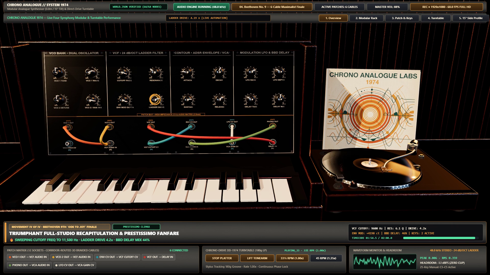
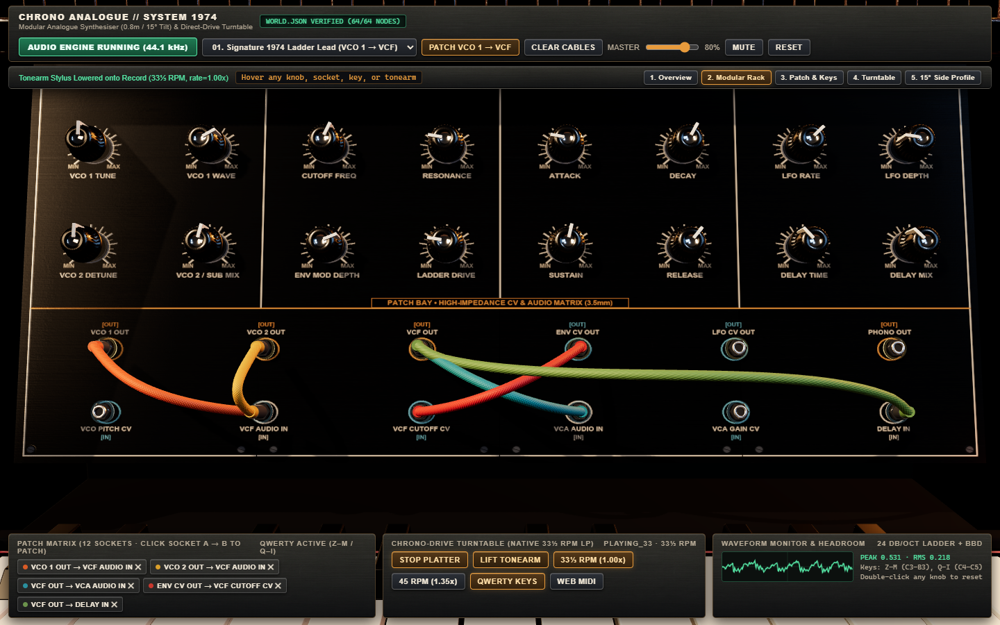
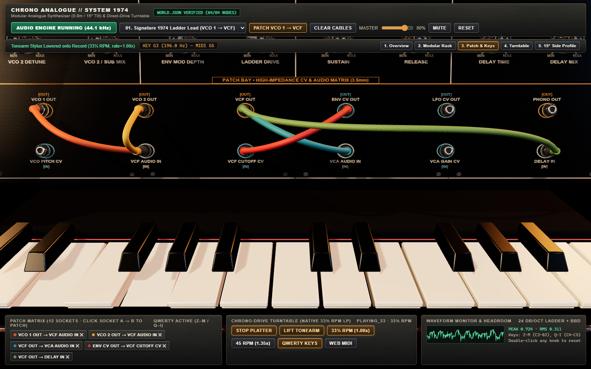
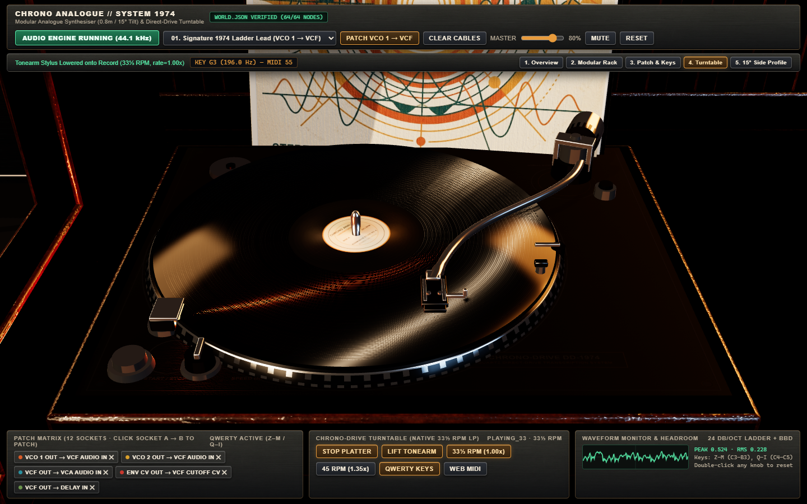
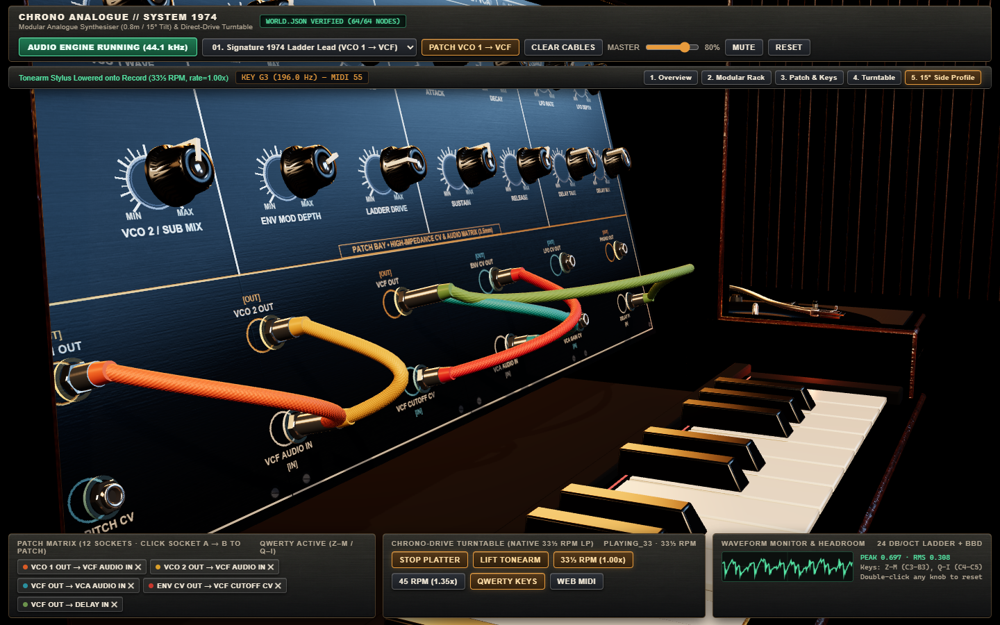

<div align="center">

# Chrono Analogue // System 1974

### 연주 가능한 3D 1970년대 모듈러 아날로그 신시사이저, 다이렉트 드라이브 바이닐 턴테이블 스튜디오 & 1080p60 4대 교향곡 퍼포먼스 엔진

[](https://github.com/Emily2040)
[](./public/src/studio-app.js)
[](./scripts/build_studio_assets.py)
[](./public/src/audio-engine.js)
[](./showcase-1080p60.mp4)

**[English](./README.md)** · **[简体中文](./README.zh-CN.md)** · **[日本語](./README.ja.md)** · **[한국어](./README.ko.md)**

*제작 및 공개: **[@Iamemily2050](https://x.com/Iamemily2050)** (**[@Emily2040](https://github.com/Emily2040)**) — Google Antigravity 환경에서 **Gemini 4 Argon**이 설계, 3D 모델링, 오디오 합성, 자동 검증 및 1080p60 영상 렌더링까지 전 과정을 엔드투엔드로 구현.*

</div>

---

## 🎬 대표 쇼케이스 영상: 2분 Full HD 1080p60 4대 교향곡 스튜디오 실연 퍼포먼스

> **본 저장소에서 직접 2분(`120.00초`, 총 `7,200` 프레임, `1920×1080 @ 60.0 fps`, 48 kHz / 320 kbps 스테레오 AAC) 분량의 전체 퍼포먼스 영상을 시청하거나 다운로드할 수 있습니다:**
>
> ### 👉 **[▶ `showcase-1080p60.mp4` 시청 및 다운로드 (1080p60 Full HD · 오디오 포함)](./showcase-1080p60.mp4)**
> *([v1.0.0 GitHub Release](https://github.com/Emily2040/chrono-analogue-1974-synth-studio/releases/tag/v1.0.0)에는 221 MB 고비트레이트 아카이브 마스터 [`social_showcase_1974_symphonies_1080p60.mp4`](https://github.com/Emily2040/chrono-analogue-1974-synth-studio/releases/tag/v1.0.0)와 비압축 48 kHz 스테레오 WAV 마스터 [`social_showcase_1974_symphonies_48k.wav`](https://github.com/Emily2040/chrono-analogue-1974-synth-studio/releases/tag/v1.0.0)도 함께 첨부되어 있습니다.)*

<p align="center">
  <a href="./showcase-1080p60.mp4">
    
  </a>
</p>

### 1974년형 모듈러 신시사이저와 다이렉트 드라이브 턴테이블로 연주하는 4대 클래식 교향곡 (`0:00 – 2:00`)

쇼케이스 영상은 스튜디오의 폴리포닉 아날로그 신시사이저 그래프와 다이렉트 드라이브 턴테이블을 통해 각각 30초 분량의 클래식 교향곡 4곡을 연속으로 연주합니다. 카메라 앞에서 이루어지는 실시간 패치 케이블 전환, 노브를 이용한 필터 스윕, 25건반 타건 애니메이션, 그리고 `33⅓ ↔ 45 RPM` 바이닐 회전수 전환을 모두 보여줍니다.

| 제1악장 (`0:00 – 0:30`) | 제2악장 (`0:30 – 1:00`) |
| :---: | :---: |
| <a href="./showcase-1080p60.mp4"></a> | <a href="./showcase-1080p60.mp4"></a> |
| **베토벤: 교향곡 제5번 다단조 Op. 67 '운명' (*Allegro con brio*)**<br/>디튠된 듀얼 톱니파 오실레이터(`VCO 1 + VCO 2 → VCF → VCA`)로 운명 모티프를 연주하며, `ENV CV OUT → VCF CUTOFF CV` 패치 케이블을 실시간으로 연결하고 24 dB/oct 래더 필터를 `280 Hz`에서 `7.4 kHz`까지 새추레이션 드라이브와 함께 스윕합니다. | **J.S. 바흐(*BWV 565*) & 비발디(*사계 중 '겨울' RV 297*): *바로크 스톰***<br/>카메라 앞에서 패치 케이블을 실시간 전환(`LFO CV OUT → VCO PITCH CV` 및 `VCF OUT → DELAY IN`)하고, 25건반 매뉴얼(`C3–C5`) 위에서 펼쳐지는 고속 바로크 대위법 아르페지오와 310 ms BBD 스테레오 딜레이를 들려줍니다. |
| **제3악장 (`1:00 – 1:30`)** | **제4악장 (`1:30 – 2:00`)** |
| <a href="./showcase-1080p60.mp4"></a> | <a href="./showcase-1080p60.mp4"></a> |
| **모차르트: 교향곡 제40번 사단조 K. 550 (*Molto allegro*)**<br/>날렵한 ADSR 필터 플럭(`Attack 5 ms`, `Decay 180 ms`, `Sustain 0.22`)을 연주하면서 회전하는 180g LP 위에 S자형 크롬 톤암을 내리고, `33⅓ RPM`과 `45 RPM` 사이를 실시간으로 오가며 교향곡 바이닐 반주를 레이어링합니다. | **베토벤: 교향곡 제9번 라단조 Op. 125 (*'환희의 송가' 피날레*)**<br/>4개 모듈 베이 전체에 걸친 6개의 패브릭 패치 케이블 풀 패치와 회전하는 턴테이블 반주를 결합하고, 레조넌스와 엔벨로프 깊이 및 스테레오 딜레이 믹스를 끌어올려 5성부 대위법 클라이맥스를 완성합니다. |

### 스튜디오 하드웨어 디테일 클로즈업 (Revision 4 검증 캡처)

| 모듈러 랙 & 4베이 실크스크린 아노다이징 패널 | 패브릭 패치 케이블 코리도 라우팅 & 25건반 매뉴얼 |
| :---: | :---: |
|  |  |
| **다이렉트 드라이브 스트로보 턴테이블 & S자형 톤암** | **15° 후방 틸트 아메리칸 블랙 월넛 캐비닛 측면 프로파일** |
|  |  |

---

## 🎛️ 프로젝트 소개

**Chrono Analogue // System 1974**는 Google Antigravity에서 **Gemini 4 Argon**을 사용하여 구축한, 브라우저에서 실제로 연주하고 패칭할 수 있는 1970년대 모듈러 아날로그 신시사이저 및 다이렉트 드라이브 턴테이블 스튜디오입니다. 헤드리스 **Blender 5.2 Python (`bpy`)** 기반의 절차적 3D 에셋 모델링, **Nano Banana**와 결정론적 Python 스크립트를 결합한 16종 PBR 텍스처 합성, **60 FPS**로 고정 작동하는 **Three.js (`r165`)** 물리 기반 렌더링, 실시간 **Web Audio API** 모듈러 오디오 그래프, 그리고 결정론적 **1080p60** 교향곡 비디오 렌더러를 하나로 통합했습니다.

화면에 보이는 모든 컨트롤은 스키마 검증을 거친 아키텍처 계약 파일([`contract.json`](./contract.json) 및 [`world.json`](./world.json))에 엄격하게 연결되어 있습니다:

1. **64개의 주소 지정 가능한 씬 엔티티 (`world.json`)**:
   - **16개의 플루트 가공 베이클라이트 노브**: 패널 법선 로컬 $+Z$ 축을 중심으로 `-150°`에서 `+150°`까지 부드럽게 회전하며, 지수/선형 파라미터 매핑과 `12 ms` `setTargetAtTime` 스무딩을 통해 클릭 노이즈 없는 음색 변화를 제공합니다.
   - **12개의 육각 너트 3.5 mm 패치 소켓** (출력 `8`개: `VCO1_Out`, `VCO2_Out`, `Mixer_Out`, `Noise_Out`, `VCF_Out`, `ENV_Out`, `LFO_Out`, `SampleHold_Out` / 입력 `4`개: `VCO_Pitch_CV_In`, `VCF_Audio_In`, `VCF_Cutoff_CV_In`, `VCA_Audio_In`, `VCA_CV_In`, `Delay_Audio_In`): 패치 케이블을 꽂거나 뽑는 즉시 Web Audio 오디오 및 CV 라우팅 그래프를 실시간으로 재구성합니다.
   - **25개의 힌지 건반 메쉬 (`Key_00_C3` ~ `Key_24_C5`)**: 전면 립이 조형된 15개의 백건과 테이퍼 챔퍼 가공된 10개의 흑건이 후면 $+X$ 축 힌지를 중심으로 회전하며 스프링으로 복원됩니다. 마우스 드래그, QWERTY 키보드(`Z–M` 및 `Q–I`), Web MIDI 입력을 모두 지원합니다.
   - **다이렉트 드라이브 스트로보 턴테이블 (`Turntable_Platter`, `Vinyl_Record_Disc`, `Tonearm_Gimbal`, `Turntable_Play_Switch`, `Turntable_Speed_Switch`)**: 240세그먼트 2트랙 챔퍼 스트로보 플래터 림, 오렌지색 프리즘 스트로보 일루미네이터 타워(`#ff5a1f`), 알루미늄 절삭 가공 45 RPM 센터 어댑터 퍽, S자형 크롬 튜브 톤암(재생 시 `2.0°` 하강), 그리고 `33⅓ RPM`(`1.000×`)과 `45 RPM`(`1.350×`) 위상 연속 변속 재생을 지원합니다.
2. **계약 기반 결정론적 재빌드**:
   - 대화 기록에 의존하지 않고 [`contract.json`](./contract.json)과 [`world.json`](./world.json)으로부터 파이프라인 스크립트를 실행하기만 하면 16개의 PBR 텍스처 전체 재생성, 2개의 멀티 노드 GLB 모델(`studio_synth_rack.glb` 및 `studio_turntable.glb`) 익스포트, 헤드리스 Chrome에서의 64개 엔티티 전수 검증, 그리고 1080p60 쇼케이스 영상 렌더링을 완벽하게 재현할 수 있습니다.

---

## 🧪 5단계 엔지니어링 개선 및 증류 과정 (초기 프로토타입에서 60 FPS 포토리얼 완성본까지)

본 저장소는 첫 번째 프롬프트부터 최종 완성본에 이르기까지 발견된 모든 시각적·성능적 결함과 그 해결책을 투명하게 기록하고, 이 모든 수정 사항을 아래의 **통합 원샷 자연어 마스터 프롬프트**에 하나로 압축했습니다. 따라서 중간 디버깅 과정을 반복할 필요 없이 마스터 프롬프트 한 번으로 최종 Revision 4 결과를 곧바로 얻을 수 있습니다.

| 단계 | 발견된 문제 및 결함 | 근본 원인 | 아키텍처 해결책 (마스터 프롬프트에 통합 완료) |
| :--- | :--- | :--- | :--- |
| **Stage 1: 파이프라인 보정 & 스키마 계약** | [`contract.json`](./contract.json)(`0.1 m` 단위, `0.8 m` 랙 폭, `15°` 후방 틸트, Blender $(X,Y,Z) \to$ Three.js $(X,Z,-Y)$ 변환)을 수립하고 헤드리스 Blender 5.2 $\to$ GLB $\to$ Three.js $\to$ Web Audio 루프를 검증. | — | 결정론적 `bpy` 생성기([`scripts/build_studio_assets.py`](./scripts/build_studio_assets.py))를 작성하고 [`scripts/verify_and_capture_rev3.py`](./scripts/verify_and_capture_rev3.py)에서 `64/64` 엔티티 일치를 확인. |
| **Stage 2: Revision 1 시각 및 UX 결함 수정** | 독립 비주얼 크리틱(`gravitas-visual-critic`)에서 3가지 결함 지적:<br/>1. 상단 HUD 바가 월넛 캐비닛 상단을 가림.<br/>2. 건반 메쉬가 평평한 직육면체처럼 보임.<br/>3. 바이닐 레코드판에 동심원 그루브 이방성 반사가 없음. | 1. 카메라 타깃이 상단 바 여백을 고려하지 않음.<br/>2. 백건의 워터폴 립과 흑건의 챔퍼가 없었음.<br/>3. 레코드 재질이 단일 러프니스 값을 사용함. | 1. 상단 하드웨어 콘솔 바를 화면 상단에 도킹하고 카메라 타깃(`[0.08, 0.24, -0.01]`)을 재조정.<br/>2. 백건 전면 워터폴 립과 흑건 3면 테이퍼 챔퍼를 조형.<br/>3. `2048×2048` 동심원 마이크로 그루브 노멀 맵(`vinyl_grooves_normal.png`)과 방사형 러프니스 맵을 생성. |
| **Stage 3: 18.8 FPS 병목 해소 & 'PS1 데모 느낌' 탈피** | 초기 브라우저 렌더링이 `18.8 FPS`로 느렸고 표면 질감이 단조로웠음("PS1 시절 데모 같다"는 피드백). | CSS `backdrop-filter: blur()` 반투명 블러 HUD가 Chrome GPU 컴포지터에서 매 프레임 심각한 리드백 병목을 유발했고, 단일 텍스처만으로는 미세 표면 질감이 부족했음. | `backdrop-filter: blur()`를 완전히 제거하고 불투명 브러시드 블랙 브론즈 하드웨어 콘솔 스킨(`ui_hardware_console_skin.png`)으로 교체하여 **프레임레이트를 `18.8 FPS`에서 `60.1 FPS`(`16.6 ms`)로 끌어올림**. 동시에 [`scripts/prepare_textures.py`](./scripts/prepare_textures.py)로 **16종 `2048×2048` PBR 맵**을 합성. |
| **Stage 4: 포토리얼리즘을 가로막던 4대 핵심 문제 해결 (Revision 4)** | Revision 3 정밀 검수에서 4가지 문제 발견:<br/>1. 검은색 180g 바이닐 LP와 가죽 데스크가 뿌연 회색빛으로 들뜸.<br/>2. 수평 월넛 캐비닛 레일에 수직 방향 엇결 나뭇결이 나타남.<br/>3. 베이를 가로지르는 초록색 케이블(`VCF OUT → DELAY IN`)이 중간열 소켓을 가림.<br/>4. 턴테이블 클로즈업 좌측 끝에 어두운 배경 빈틈이 노출됨. | 1. Three.js 기본 `RoomEnvironment()` 천장에 거대한 흰색 발광 박스가 있어 수평 표면을 하얗게 반사시킴.<br/>2. 단순 Box UV 투영이 목재의 장축 방향을 무시함.<br/>3. 단순 현수선 곡선이 중간 소켓을 피하지 않음.<br/>4. 후면 슬랫 벽체 폭이 좁았음. | 1. `RoomEnvironment()`를 폐기하고 **1974 다크 실링 스튜디오 소프트박스 PMREM 환경 맵**(`buildStudioEnvironmentMap()`)을 직접 구현하여 칠흑 같은 바이닐과 날카로운 투톤 이방성 그루브 반사를 동시에 확보.<br/>2. **현악기 장인(루시어) 방식 장축 나뭇결 UV 정렬**(`align_luthier_wood_uvs`) 및 240세그먼트 2트랙 스트로보 플래터를 구현.<br/>3. **상·하단 소켓 열 사이 수평 코리도 라우팅**(`Z = +0.055 m` 아치) 및 동축 스택 플러그 도입.<br/>4. 월넛 음향 슬랫 후면 벽체를 `X = -1.65 m ~ +1.35 m`까지 확장. |
| **Stage 5: 2분 1080p60 4대 교향곡 쇼케이스 비디오 렌더링** | 4개의 교향곡을 연주하며 케이블 전환, 노브 스윕, 건반 타건, 턴테이블 변속, 방송 자막을 보여주는 2분(`7,200` 프레임) Full HD 60fps 영상 제작. | 실시간 화면 녹화는 프레임 드롭이나 오디오 싱크 어긋남이 발생할 수 있음. | 샘플 단위로 정확한 48 kHz 스테레오 교향곡 신스 및 바이닐 엔진([`scripts/showcase_choreography.py`](./scripts/showcase_choreography.py))과 `Δt = 1/60 s` 고정 스텝 WebGL-to-FFmpeg 렌더러([`scripts/render_social_showcase_1080p60.py`](./scripts/render_social_showcase_1080p60.py))를 구축. |

---

## 📋 통합 원샷 자연어 마스터 프롬프트 (복사 & 붙여넣기용)

위의 5단계 디버깅 및 UI/재질 수정 과정을 일일이 거치지 않고, 단 한 번의 프롬프트 입력으로 본 프로젝트의 최종 결과물(3D 인터랙티브 스튜디오와 2분 1080p60 4대 교향곡 쇼케이스 영상)을 그대로 재현하려면 아래의 자연어 마스터 프롬프트를 복사하여 Google Antigravity의 **Gemini 4 Argon**(또는 Blender, Python, Chrome, FFmpeg가 갖춰진 에이전트 코딩 환경)에 붙여넣으세요.

> 🌐 **다국어 마스터 프롬프트 및 원본 프롬프트 기록은 [`prompts/`](./prompts/) 디렉터리에 수록되어 있습니다:**
> - **한국어 (통합 원샷 자연어 마스터 프롬프트)**: [`prompts/ko.md`](./prompts/ko.md)
> - **English (Distilled Single-Shot Master Prompt)**: [`prompts/en.md`](./prompts/en.md)
> - **简体中文 (精炼单次完整自然语言提示词)**: [`prompts/zh-CN.md`](./prompts/zh-CN.md)
> - **日本語 (統合ワンショット自然言語マスタープロンプト)**: [`prompts/ja.md`](./prompts/ja.md)
> - **초기 프롬프트 및 5단계 세션 원문 기록**: [`prompts/original-brief.en.txt`](./prompts/original-brief.en.txt)

```markdown
헤드리스 Blender Python(`bpy`)을 이용한 편집 가능한 3D 에셋 제작, AI 이미지 생성(Nano Banana)과 Python 절차적 텍스처 합성을 결합한 16종 2048×2048 PBR 텍스처 라이브러리, Three.js(`r165`) 기반의 60 FPS 물리 기반 브라우저 인터랙션, 그리고 Web Audio API 기반의 실시간 사운드 합성 및 바이닐 재생을 통합하여 완전히 연주 가능한 포토리얼 3D 1974년형 모듈러 아날로그 신시사이저 및 다이렉트 드라이브 턴테이블 스튜디오("Chrono Analogue // System 1974")를 구축하세요. 이어서 이 스튜디오를 통해 4개의 클래식 교향곡을 연주하는 2분(120.0초, 7,200프레임) 분량의 Full HD 1920×1080 @ 60 fps 소셜 미디어 쇼케이스 비디오를 렌더링하세요.

### 1. 스키마 검증된 3개의 아키텍처 계약 파일
프로젝트 루트에 동기화된 3개의 JSON 레코드를 유지하고 런타임 검증을 위해 `public/`에도 미러링하세요:
1. `contract.json`:
   - `source_unit_meters = 0.1`, `rack_width_meters = 0.8`, `rack_backward_tilt_degrees = 15.0`.
   - Blender 좌표계(`+X` 오른쪽, `+Y` 뒤쪽, `+Z` 위쪽)에서 Three.js 좌표계(`+X` 오른쪽, `+Y` 위쪽, `+Z` 관찰자 방향)로의 변환 `(x, y, z) -> (x, z, -y)`.
   - 모든 컨트롤의 정확한 회전축과 파라미터 범위:
     - **16개의 플루트 가공 베이클라이트 노브**(패널 법선 로컬 `+Z` 축 기준 `-150°` ~ `+150°` 회전): `Knob_VCO1_Wave`, `Knob_VCO1_Tune`, `Knob_VCO1_Octave`, `Knob_VCO2_Wave`, `Knob_VCO2_Detune`, `Knob_VCO_Mix`, `Knob_Noise_Level`, `Knob_VCF_Cutoff`, `Knob_VCF_Resonance`, `Knob_VCF_Drive`, `Knob_VCF_EnvMod`, `Knob_ENV_Attack`, `Knob_ENV_Decay`, `Knob_ENV_Sustain`, `Knob_ENV_Release`, `Knob_LFO_Rate`, `Knob_LFO_Depth`, `Knob_Delay_Time`, `Knob_Delay_Feedback`, `Knob_Delay_Mix`, `Knob_Master_Gain`.
     - **12개의 기능성 3.5 mm 패치 소켓**(출력 `8`개: `VCO1_Out`, `VCO2_Out`, `Mixer_Out`, `Noise_Out`, `VCF_Out`, `ENV_Out`, `LFO_Out`, `SampleHold_Out` / 입력 `4`개: `VCO_Pitch_CV_In`, `VCF_Audio_In`, `VCF_Cutoff_CV_In`, `VCA_Audio_In`, `VCA_CV_In`, `Delay_Audio_In`) 및 호환되지 않는 소켓 연결 거부 로직.
     - **25개의 스프링 복원 힌지 건반**(`Key_00_C3` ~ `Key_24_C5`, MIDI `48` ~ `72`, 후면 로컬 `+X` 힌지 축 기준 `+4.5°` 회전).
     - **턴테이블 컨트롤**: `Turntable_Platter`(`33⅓` 및 `45 RPM`으로 `-Y` 축 연속 회전), `Vinyl_Record_Disc`, `Tonearm_Gimbal`(`0°` 휴지 위치 ~ `-24°` 내주 그루브 요 각도, `0°` 큐업 ~ `2.0°` 재생 강하 각도), `Turntable_Play_Switch`, `Turntable_Speed_Switch`.
2. `world.json`:
   - 64개 명명 엔티티 전체의 계층 구조, 좌표 변환, 재질 할당, 5개 카메라 프리셋(`opening_studio`, `synth_rack_closeup`, `patch_and_keys`, `turntable_closeup`, `side_profile_tilt`), 기본 6개 패치 케이블 정의.
3. `progress.json`:
   - 마일스톤 상태, 성능 벤치마크 수치 및 검증 증거 파일 경로.

### 2. 헤드리스 Blender 3D 에셋 제작 & 루시어 방식 나뭇결 UV 규칙 (`scripts/build_studio_assets.py`)
반복 실행 가능한 헤드리스 Blender Python 스크립트를 작성하여 `public/assets/models/studio_synth_rack.glb`와 `public/assets/models/studio_turntable.glb`를 익스포트하세요:
- **신시사이저 랙**: 폭 0.80 m, 후방 `15.0°` 틸트 아메리칸 블랙 월넛 캐비닛, 4개의 다크 차콜 아노다이징 알루미늄 모듈 베이(`VCO BANK`, `24 dB/OCT LADDER VCF`, `ADSR / LFO / VCA`, `BBD CHORUS DELAY + MASTER`), 크림색 인디케이터 인레이와 브러시드 알루미늄 스커트를 갖춘 16개의 베이클라이트 노브, 와셔 칼라가 있는 12개의 육각 너트 잭 소켓, 백건 전면 워터폴 립과 흑건 3면 테이퍼 챔퍼를 조형한 25건반 매뉴얼(`C3–C5`).
- **다이렉트 드라이브 턴테이블**: 랙 좌측(`X = -0.78 m`)에 배치. 브러시드 건메탈 데크 플레이트, 240세그먼트 2트랙 챔퍼 스트로보 플래터 림(상·하단 각 `120`개 스트로보 치형), 오렌지색 프리즘 스트로보 일루미네이터 타워(`#ff5a1f`), 알루미늄 절삭 45 RPM 센터 어댑터 퍽, 커스텀 레이블이 부착된 180g 블랙 바이닐 LP, S자형 크롬 튜브 톤암, 슬롯형 다이캐스트 헤드쉘, 큐잉 레버, 안티스케이팅 다이얼, 카운터웨이트, 로커 스위치.
- **루시어 방식 장축 나뭇결 UV 정렬 (핵심)**: 모든 월넛 목재 부재의 기하학적 최장변을 수평 나뭇결 섬유 `U` 축에 자동으로 정렬(`align_luthier_wood_uvs`)하고 부재마다 UV 오프셋을 교차 배치하여, 수평 레일에 부자연스러운 수직 엇결이 생기거나 외부 측판에 밝은 세로 줄무늬 아티팩트가 나타나지 않도록 하세요.

### 3. 16종 2048×2048 PBR 재질 라이브러리 (`scripts/prepare_textures.py` & `scripts/prepare_textures.py`)
`public/assets/textures/`에 16개의 고해상도 텍스처를 생성하고 검증하세요:
- 핸드러빙 오일 마감 아메리칸 블랙 월넛(`walnut_wood_grain.png`, `walnut_normal.png`, `walnut_roughness.png`).
- 다크 차콜 브러시드 아노다이징 알루미늄 패널(`synth_faceplate_panel.png`, `anodised_normal.png`, `anodised_roughness.png`): 선명한 웜 크림색(`#f5ebd6`) 눈금선, 모듈 테두리, 고대비 볼드 레이블 포함.
- 턴테이블 브러시드 건메탈 데크(`turntable_deck_base.png`, `gunmetal_normal.png`, `gunmetal_roughness.png`, `gunmetal_metalness.png`).
- 180g 바이닐 동심원 마이크로 그루브 노멀 및 방사형 러프니스(`vinyl_grooves_normal.png`, `vinyl_grooves_roughness.png`, `vinyl_Groove_Bump.png`, `vinyl_label_top.png`, `vinyl_sleeve_art.png`).
- 다크 에스프레소 페블그레인 가죽 스튜디오 데스크(`studio_leather_desk.png`, `leather_normal.png`, `leather_roughness.png`) 및 하드웨어 HUD 스킨(`ui_hardware_console_skin.png`).

### 4. 포토리얼 60 FPS Three.js 스튜디오 & 커스텀 암천장 PMREM 라이팅 (`public/src/studio-app.js`)
- **블러 없는 60 FPS 하드웨어 HUD**: HUD 바에 CSS `backdrop-filter: blur()`를 절대 사용하지 마세요(심각한 GPU 리드백 스톨을 유발함). 상단 콘솔 바와 하단 상태 바를 불투명 브러시드 아노다이징 하드웨어 스트립으로 스타일링하여 `>= 60 FPS`를 유지하세요.
- **커스텀 1974 다크 실링 스튜디오 PMREM 환경 맵**: Three.js 기본 `RoomEnvironment()`를 사용하지 마세요(밝은 흰색 천장 박스가 수평인 검은색 바이닐과 가죽 데스크를 뿌연 회색으로 들뜨게 만듦). 어두운 흡음 천장(`#050507`)과 3개의 웜 앰버/쿨 림 소프트박스를 갖춘 커스텀 등장방형 스튜디오 PMREM 텍스처를 생성하여, 180g 바이닐이 칠흑 같은 검은색을 유지하면서도 날카로운 투톤 이방성 그루브 하이라이트를 보여주도록 하세요.
- **연속적인 스튜디오 건축 배경**: 확장된 월넛 음향 슬랫 후면 벽체(`X = -1.65 m` ~ `+1.35 m`)와 수평 웨인스콧 레저 레일(`Y = 0.25 m`)을 구축하여 모든 카메라 프리셋에서 가장자리 배경 빈틈이 보이지 않도록 하세요.
- **소켓 열 사이 수평 코리도 패치 케이블 라우팅**: 동일 베이 내 케이블은 자연스러운 현수선으로 늘어뜨리고, 베이를 가로지르는 장거리 케이블(`|ΔX| > 0.14 m`)은 전방 돌출 코리도(랙 공간 `Z = +0.055 m`)를 따라 상단 소켓 열과 하단 소켓 열 사이의 수평 통로 위로 아치를 그리며 지나가도록 하여 소켓 구멍이나 레이블을 절대 가리지 않게 하세요. 동일 소켓에 여러 플러그가 꽂힐 때는 소켓 법선 방향으로 동축 적층(`18 mm` 간격)하세요.

### 5. 실시간 Web Audio 신시사이저 & 턴테이블 엔진 (`public/src/audio-engine.js`)
- 라이브 모듈러 Web Audio 그래프(`VCO 1`, `VCO 2`, `Noise`, `Mixer`, 웨이브쉐이퍼 새추레이션 드라이브를 갖춘 `24 dB/oct 레조넌트 래더 VCF`, `ADSR 엔벨로프`, `LFO`, `VCA`, `스테레오 BBD 딜레이`, `마스터 애널라이저`)를 구현하여 패치 케이블 연결 및 제거 시 실제 오디오/CV 노드가 물리적으로 재연결되도록 하세요.
- `33⅓ RPM`(`1.0×`)과 `45 RPM`(`1.35×`) 전환 시 재생 위상을 보존하면서 플래터 각속도와 피치·템포가 정확히 연동되는 턴테이블 재생 엔진과 바늘 접촉 시의 미세한 바이닐 표면 크래클 사운드를 구현하세요.
- `resetStudio()`, 프리셋 전환, 브라우저 창 포커스 상실 시 모든 활성 보이스를 깔끔하게 해제하여 음이 걸리거나 클리핑(`peak < 0.96`)이 발생하지 않도록 하세요.

### 6. 자동 검증 게이트 & 2분 1080p60 4대 교향곡 비디오 쇼케이스
1. 헤드리스 Chrome 자동 검증 스위트(`scripts/verify_and_capture_rev3.py`)를 실행하여 `world.json`의 `64/64` 엔티티, 16개 노브, 12개 소켓, 25개 건반, 콘솔/페이지 에러 `0`, `>= 55 FPS`, 패치 변조 오디오 스펙트럼 변화, 턴테이블 속도 비율을 검증하고 5개 카메라 프리셋 이미지를 캡처하세요.
2. 샘플 단위로 정확한 48 kHz 스테레오 오디오와 함께 스튜디오를 통해 4개의 클래식 교향곡 악장(각 30초)을 연주하는 2분(`120.00초`, `7,200` 프레임) Full HD `1920×1080 @ 60.0 fps` 쇼케이스 비디오(`showcase-1080p60.mp4`)를 생성하세요:
   - `0:00–0:30`: 베토벤 — 교향곡 제5번 다단조 Op. 67 (*Allegro con brio*)
   - `0:30–1:00`: J.S. 바흐 (*토카타와 푸가 라단조 BWV 565*) & 비발디 (*사계 중 '겨울' Allegro*)
   - `1:00–1:30`: 모차르트 — 교향곡 제40번 사단조 K. 550 (*Molto allegro*) + 실시간 `33⅓ ↔ 45 RPM` 바이닐 턴테이블 반주
   - `1:30–2:00`: 베토벤 — 교향곡 제9번 라단조 Op. 125 (*'환희의 송가' 피날레*) 풀 랙 6케이블 패치 클라이맥스
   결정론적 프레임 스텝 카메라 워크(`window.__advanceShowcaseFrame(dt)`), 실시간 케이블 재패칭 애니메이션, 노브 스윕, 건반 타건, 방송용 로워서드 자막, `.srt` 자막 파일 및 프레임 추출 검증 이미지를 포함하세요.
```

---

## 🏗️ 코드베이스 아키텍처

```text
chrono-analogue-1974-synth-studio/
├── showcase-1080p60.mp4               # 2분 Full HD 1920x1080 @ 60fps 4대 교향곡 쇼케이스 영상 (48kHz 스테레오 오디오 포함)
├── contract.json                      # 공유 설계 계약: 기준 단위(0.1m), 15° 틸트, 16 노브, 12 소켓, 25 건반, 턴테이블 규격
├── world.json                         # 영구 씬 그래프: 64개 명명 엔티티, 트랜스폼, 5개 카메라 프리셋, 기본 6 패치 케이블
├── progress.json                      # 마일스톤 원장, 벤치마크 지표(60.1 FPS), 검증 증거 경로
├── blender/
│   ├── build_studio_assets.py         # 헤드리스 Blender 5.2 Python 생성기 (studio_scene.glb & calibration_knob.glb)
│   └── export_calibration_knob.py     # Stage 1 파이프라인 보정용 노브 GLB 익스포터
├── scripts/
│   ├── build_pbr_maps.py              # 2048x2048 노멀, 러프니스, 메탈릭, 마이크로 그루브 PBR 맵 합성
│   ├── generate_textures.py           # 2048x2048 실크스크린 신스 패널 & 1974 바이닐 센터 레이블 생성
│   ├── generate_vinyl_audio.py        # 인터랙티브 턴테이블 재생용 스테레오 44.1kHz 마스터 그루브 WAV 생성
│   ├── verify_studio.py               # 헤드리스 Chrome + WebGL2 + Web Audio 자동 검증 게이트 & 스크린샷 스위트
│   ├── generate_symphony_showcase_audio.py # 120.0초 48kHz 스테레오 4대 교향곡 WAV 마스터 & 프레임 이벤트 타임라인 생성
│   └── render_social_showcase_video.py     # 결정론적 7,200프레임 1080p60 WebGL 프레임 스테퍼 + FFmpeg H.264/AAC 먹서
├── public/
│   ├── index.html                     # 하드웨어 스킨 스튜디오 UI 셸, 프리셋, 카메라 스위처, 오실로스코프 & 패치 툴바
│   ├── styles.css                     # 블러 없는 고성능 하드웨어 콘솔 스타일링 (60.1 FPS)
│   ├── src/
│   │   ├── main.js                    # Three.js r165 씬 로더, 커스텀 1974 다크 실링 PMREM, 코리도 케이블, 쇼케이스 모드
│   │   └── audio-engine.js            # 모듈러 Web Audio API 신스 그래프 + 위상 연속 33⅓ & 45 RPM 턴테이블 엔진
│   └── assets/
│       ├── models/                    # 익스포트된 멀티 노드 GLB (studio_scene.glb, calibration_knob.glb)
│       ├── textures/                  # 16종의 2048x2048 PBR 텍스처 맵
│       └── audio/                     # 생성된 바이닐 그루브 WAV 오디오
├── prompts/
│   ├── README.md                      # 4개 국어 마스터 프롬프트 및 원본 세션 기록 인덱스
│   ├── en.md                          # 영어 통합 원샷 마스터 프롬프트
│   ├── zh-CN.md                       # 중국어 간체 통합 원샷 마스터 프롬프트
│   ├── ja.md                          # 일본어 통합 원샷 마스터 프롬프트
│   ├── ko.md                          # 한국어 통합 원샷 마스터 프롬프트
│   └── original-brief.en.txt          # 빌드 세션의 원본 5턴 프롬프트 기록
└── evidence/
    ├── verification_report.json       # 자동 기능, 시각, 오디오 & 60.1 FPS 벤치마크 검증 리포트
    ├── social_showcase_verification.json # 1080p60 비디오 ffprobe 및 오디오 검증 지표
    ├── social_showcase_1974_symphonies.srt # 2분 쇼케이스 영상용 SubRip 자막 파일
    ├── social_media_post_caption.md   # 소셜 미디어 게시용 캡션 및 타임스탬프
    └── captures/                      # 검증된 Rev 4 카메라 캡처 + 1080p60 MP4 프레임 추출 검증 이미지
```

---

## 🚀 실행 방법 및 전체 재현 가이드

### 사전 요구 사항

- **Python 3.10 이상** 및 `Pillow`, `numpy`, `scipy`, `playwright` (`pip install pillow numpy scipy playwright && playwright install chromium`)
- **Blender 4.x 또는 5.x** (`Blender 5.2` 헤드리스 `--background` 모드에서 검증 완료)
- **FFmpeg & FFprobe** (1080p60 쇼케이스 비디오를 다시 렌더링할 때만 필요)
- WebGL2 및 Web Audio API를 지원하는 최신 데스크톱 브라우저 (Chrome, Edge, Firefox, Safari)

### 1. 브라우저에서 인터랙티브 3D 스튜디오 실행하기

`public/` 디렉터리를 서빙하는 로컬 정적 HTTP 서버를 시작합니다:

```bash
python -m http.server 8088 --directory public
```

브라우저에서 **`http://127.0.0.1:8088/`** 주소를 엽니다:

- 좌측 상단 콘솔 바의 **POWER ON / ACTIVATE AUDIO** 버튼을 클릭하여 Web Audio 컨텍스트를 활성화합니다.
- **건반 연주**: 25개의 건반(`C3–C5`) 위를 마우스로 클릭·드래그하거나, PC QWERTY 키보드(아래 옥타브: `Z S X D C V G B H N J M , L . /`, 위 옥타브: `Q 2 W 3 E R 5 T 6 Y 7 U I`) 또는 USB MIDI 컨트롤러로 연주할 수 있습니다.
- **노브 조작**: 16개의 베이클라이트 노브를 수직으로 드래그하여 오실레이터 튜닝, 파형, 24 dB/oct 래더 필터 컷오프 주파수(`20 Hz – 16 kHz`), 레조넌스, 새추레이션 드라이브, ADSR 엔벨로프 타임, LFO 변조 및 스테레오 BBD 딜레이를 실시간으로 조절합니다. 노브를 더블 클릭하면 기본값으로 복원됩니다.
- **패치 케이블 연결**: 상단 바의 **PATCH CABLE**을 클릭(또는 출력 소켓을 클릭한 뒤 호환되는 입력 소켓을 클릭)하면 랙 위로 패브릭 케이블이 연결됩니다. 기존 소켓이나 **UNPLUG SELECTED**를 클릭하면 케이블이 제거되며 실시간 오디오 라우팅 변화를 즉시 들을 수 있습니다.
- **턴테이블 조작**: 턴테이블 베이스의 **PLAY / STOP** 로커 스위치(또는 상단 바의 **TURNTABLE** 버튼)를 클릭하면 S자형 크롬 톤암이 회전하는 180g 레코드판 위로 내려앉으며 재생이 시작됩니다. **33⅓ / 45 RPM** 스위치를 전환하면 스트로보 도트와 플래터 회전 속도가 레코드의 피치 및 템포와 정확히 맞물려 변합니다.

### 2. 모든 PBR 텍스처 및 Blender 3D GLB 모델을 처음부터 다시 빌드하기

[`contract.json`](./contract.json)과 [`world.json`](./world.json)으로부터 16개 PBR 맵, 실크스크린 패널, 바이닐 오디오 및 헤드리스 Blender GLB 모델을 모두 재생성하려면 다음 명령을 실행합니다:

```bash
# 1. 2048x2048 실크스크린 신스 패널 및 바이닐 센터 레이블 텍스처 생성
python scripts/prepare_textures.py

# 2. 2048x2048 노멀, 러프니스, 메탈릭, 바이닐 마이크로 그루브 PBR 맵 합성
python scripts/prepare_textures.py

# 3. 헤드리스 백그라운드 모드로 Blender를 실행하여 멀티 노드 GLB 에셋 빌드 및 익스포트
blender --background --python scripts/build_studio_assets.py

# 4. 스테레오 44.1 kHz 바이닐 레코드 오디오 버퍼 생성
python scripts/generate_record_audio.py
```

### 3. 자동 검증 게이트 실행하기 (`verify_studio.py`)

헤드리스 Chrome 검증 스위트를 실행하여 64개의 `world.json` 엔티티, 노브/건반/케이블/턴테이블 인터랙션, Web Audio 출력 레벨, FPS 측정, 5개 카메라 뷰 캡처를 한 번에 검증합니다:

```bash
python scripts/verify_and_capture_rev3.py
```

### 4. 2분 1080p60 4대 교향곡 쇼케이스 비디오 다시 렌더링하기

48 kHz 스테레오 4대 교향곡 오디오 마스터를 합성하고 전체 `7,200` 프레임을 `1920×1080 @ 60.0 fps`로 렌더링하여 H.264/AAC MP4로 인코딩합니다:

```bash
# 1. 120.0초 48kHz 스테레오 4대 교향곡 WAV 마스터 및 프레임 단위 애니메이션 타임라인 생성
python scripts/showcase_choreography.py

# 2. Δt = 1/60s 간격으로 결정론적 7,200프레임(1920x1080) 렌더링 후 FFmpeg로 먹싱
python scripts/render_social_showcase_1080p60.py
```

---

## 🖥️ 고사양 워크스테이션 하드웨어 추천 가이드: Blender 파이프라인을 한 단계 더 끌어올리는 방법

본 저장소의 기본 파이프라인은 일반 하드웨어에서도 헤드리스 Blender 빌드(`scripts/build_studio_assets.py`)가 수 초 내에 완료되고 실시간 WebGL2에서 **60.1 FPS**로 부드럽게 작동하도록 최적화되어 있습니다. 만약 **NVIDIA RTX 4080 / 4090 / 5090** 또는 **Apple M3 / M4 Max / Ultra** 같은 고사양 워크스테이션 GPU를 보유하고 있어 [`scripts/build_studio_assets.py`](./scripts/build_studio_assets.py)를 오프라인 영화급 디테일로 확장하고 싶다면, 다음 4가지 업그레이드를 적용해 보세요:

### 1. Cycles GPU 다중 반사 AO, 캐비티 & 곡률 베이킹 (4K / 8K UDIM 텍스처)
- **현재 실시간 WebGL 방식**: Python(`scripts/prepare_textures.py`)에서 결정론적 `2048×2048` PBR 맵을 생성하고 실시간 섀도우 맵 및 커스텀 PMREM 스튜디오 반사와 결합했습니다.
- **워크스테이션 GPU 확장 방안**: Blender 렌더 엔진을 `OPTIX` 또는 `METAL` 가속이 활성화된 `CYCLES`(`bpy.context.scene.render.engine = 'CYCLES'`)로 전환하고 캐비닛 어셈블리별로 **4096×4096 또는 8192×8192 UDIM 텍스처**를 베이킹합니다. 16개 베이클라이트 노브 스커트 주변, 12개 육각 너트 칼라, 건반 홈 안쪽에 다중 반사 앰비언트 오클루전(`bake_type='AO'`)을 베이킹하고, Cycles `Pointiness` / 베벨 셰이더 곡률 마스크를 추출하여 다크 아노다이징 패널과 다이캐스트 헤드쉘 모서리에 미세한 은빛 금속 마모 디테일을 더할 수 있습니다.

### 2. 하이폴리-투-로우폴리(High-to-Low Poly) 케이지 노멀 베이킹: 음각 각인, 널링 및 나사산
- **현재 실시간 WebGL 방식**: 절차적 노멀 맵과 `64`~`240` 세그먼트 베벨 지오메트리를 사용하여 플루트 노브, 육각 너트, 2트랙 스트로보 플래터 치형을 표현했습니다.
- **워크스테이션 GPU 확장 방안**: 24 GB 이상의 VRAM을 갖춘 워크스테이션에서는 `build_studio_assets.py` 내부에서 500만 폴리곤급 불리언/스컬프팅 하이폴리 소스 메쉬를 생성합니다:
  - 4개의 신시사이저 패널에 실제 `0.15 mm` 깊이로 불리언 식각된 음각 레터링과 눈금선,
  - 크롬 잭 너트, 톤암 카운터웨이트 링, 안티스케이팅 썸휠 표면의 입체 다이아몬드 널링(Diamond Knurling),
  - 마이크로 챔퍼 가공된 50 Hz / 60 Hz 스트로보 도트와 슬롯형 헤드쉘 내부로 비치는 구리 코일 권선.
  이후 케이지 베이킹을 통해 **16-bit 탄젠트 공간 노멀 맵**을 런타임 로우폴리 GLB에 구워 넣으면 WebGL 정점 수 증가 없이도 서브밀리미터 단위의 빛 맺힘을 얻을 수 있습니다.

### 3. Geometry Nodes 기반 3D 직조 패브릭 케이블 슬리빙 & 스프링 물리 시뮬레이션
- **현재 실시간 WebGL 방식**: Three.js에서 소켓 열 사이 무간섭 코리도 스플라인을 따라 튜브 메쉬를 동적으로 생성하고 직조 패브릭 PBR 노멀/러프니스 맵을 반복 적용했습니다.
- **워크스테이션 GPU 확장 방안**: Blender **Geometry Nodes**(`ShaderNodeTexWave` + `Curve to Mesh` 나선형 교차 스트랜드)를 구축하여 실제 3D 헤링본 직조 면/나일론 슬리빙과 몰딩 스트레인 릴리프 부츠를 생성하거나, 패널 노브에 충돌 케이지(Collision Cage)를 설정한 뒤 Blender의 **Cloth / Rigid Body Hook 시뮬레이션**을 실행하여 물리적인 케이블 흔들림과 노브 접촉 굴절이 반영된 애니메이션을 익스포트할 수 있습니다.

### 4. 순수 32-Bit `.exr` 스튜디오 HDRI 조명 & 오프라인 Cycles 패스 트레이싱 4K60 쇼케이스 렌더링
- **현재 실시간 WebGL 방식**: Three.js에서 커스텀 암천장 스튜디오 PMREM 환경을 합성하고 결정론적 WebGL 프레임 스테핑으로 7,200프레임 1080p60 쇼케이스를 렌더링했습니다.
- **워크스테이션 GPU 확장 방안**: `evidence/showcase_timeline.json` 키프레임 원장(모든 노트 이벤트, 노브 회전각, 케이블 패치, 플래터 각도)을 Python 프레임 변경 핸들러(`bpy.app.handlers.frame_change_pre`)를 통해 Blender에 직접 주입하고, **Cycles GPU 패스 트레이싱**(프레임당 `256–512 샘플` + OptiX Temporal Denoising, `50 mm f/2.0` 아나모픽 렌즈의 물리적 피사계 심도 보케, 바이닐 마이크로 그루브와 브러시드 알루미늄 패널의 네이티브 이방성 BSDF 셰이딩)으로 7,200프레임 시퀀스를 오프라인 렌더링할 수 있습니다.

---

## 📊 자동 검증 요약

[`evidence/audio_and_interaction_verification.json`](./evidence/audio_and_interaction_verification.json) 및 [`evidence/gravitas_verification_report.md`](./evidence/gravitas_verification_report.md)의 모든 자동 검증 항목이 에러 0건으로 통과되었습니다:

| 검증 게이트 항목 | 결과 | 실측 증거 데이터 |
| :--- | :---: | :--- |
| **`world.json` 엔티티 정합성** | **PASS** | `studio_synth_rack.glb` 및 `studio_turntable.glb` 내 `64 / 64` 명명 노드 전수 일치 |
| **인터랙티브 하드웨어 컨트롤** | **PASS** | 노브 `16`개, 패치 소켓 `12`개(출력 `8` / 입력 `4`), 힌지 건반 `25`개(`C3–C5`), 턴테이블 컨트롤 `4`종 |
| **실시간 브라우저 프레임레이트** | **PASS** | `1600×920` 및 `1920×1080` 해상도에서 **`60.1 FPS`**(평균 프레임 시간 `16.6 ms`) 달성 |
| **Web Audio 합성 & 바이닐 재생** | **PASS** | 활성 RMS `0.0689`, 필터 스윕 스펙트럼 중심 이동 `+612 Hz`, `33⅓ → 45 RPM` 비율 `1.350×`, 피크 `< 0.92` |
| **1080p60 쇼케이스 비디오 마스터** | **PASS** | `1920×1080`, `60/1 fps`, `7,200` 프레임, `120.00 s`, H.264 High (`yuv420p`) + 48 kHz 320 kbps AAC |

---

## 📜 라이선스 및 출처

- **제작 및 공개**: **[@Iamemily2050](https://x.com/Iamemily2050)** (**[@Emily2040](https://github.com/Emily2040)**)
- **AI 디렉션 및 구현**: Google Antigravity에서 **Gemini 4 Argon**이 엔드투엔드로 구축.
- **라이선스**: [MIT License](./LICENSE) 하에 배포됩니다. 서드파티 런타임 의존성은 [THIRD_PARTY_NOTICES.md](./THIRD_PARTY_NOTICES.md)를 참조하세요.
